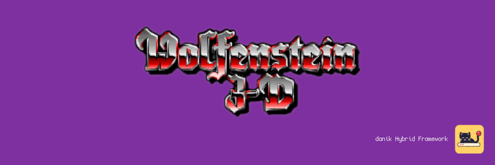

# ECWolf for MiSTer

Wolfenstein 3D and Spear of Destiny on [MiSTer FPGA](https://github.com/MiSTer-devel/Main_MiSTer/wiki) as a hybrid port.

The game itself is [ECWolf](https://maniacsvault.net/ecwolf/), the source port of the Wolfenstein 3D engine. It runs on the MiSTer's ARM CPU. The ECWolf FPGA core provides native 15kHz video (CRT, VGA and HDMI) at 320x200, 640x200, 320x240 or 640x240, 44.1kHz audio and keyboard, mouse and gamepad input. The two halves talk through shared DDR3 memory.

> **Beta.** Expect rough edges and please report problems in the issues.
>
> **Disclaimer:** AI is being extensively used to speed up development, but the project is well-maintained and supported.

  
  

## Requirements

- **danik_hybrid_ports**, the launcher: run it **once** from the MiSTer's `Scripts` menu ([The launcher](#the-launcher)). Without it the core says "Game not running".
- **Game data**, which is not included: your own copy of Wolfenstein 3D or Spear of Destiny (with its mission packs), or the shareware episode or demo.
- **Recommended:** a gamepad with two analog sticks and analog triggers, like an Xbox or PlayStation controller. A gamepad without them works but is not recommended. The game can also be played with a keyboard and mouse.

## Installation

With `update_all` (Downloader 2.4 or newer, which update_all keeps up to date):

1. Copy [`downloader_danik_hybrid_ports.ini`](https://raw.githubusercontent.com/ItsDanik/Hybrid_MiSTer/main/launcher/downloader_danik_hybrid_ports.ini) to the root of your SD card (`/media/fat`).
2. Run `update_all`. That installs the launcher, **danik_hybrid_ports**, in `Scripts`.
3. Run **danik_hybrid_ports** from the `Scripts` menu, tick the games you want and press *X: Apply*. They are installed, and update_all keeps them up to date.
4. Copy **everything** in your games' folders to `/media/fat/games/dnk/ECWolf/`, all the files as they are, and leave nothing out (files the port does not use, such as the `.EXE`s, do no harm). Each game is known by its files:

   | Game | Files |
   |---|---|
   | Wolfenstein 3D | `*.WL6` (or `*.WL3`, the first three episodes) |
   | Wolfenstein 3D shareware | `*.WL1` |
   | Spear of Destiny | `*.SOD` |
   | SoD: Return to Danger, SoD: Ultimate Challenge | `*.SD2`, `*.SD3`, next to those of Spear of Destiny |
   | Spear of Destiny demo | `*.SDM` |
5. Load the game from the `Other` menu, e.g. **dnk-Wolfenstein 3D**, or from the `Hybrid Ports` folder if you moved the games there in the launcher.

> [!NOTE]
> The game data can go on a USB drive instead, into the same folder there (`/media/usb0/games/dnk/ECWolf/`): the game looks for it there first, and then keeps its settings and saved games there as well. Everything else stays on the SD card.

The menu entry of Wolfenstein 3D starts the shareware when the full game is not there, that of Spear of Destiny the demo. When a game's files are missing, the core says which files to copy where. Each game keeps its own OSD settings and button mappings. The core file itself (`_Other/dnk/dnk-ECWolf_*.rbf`, or from *Recent*) lists the games that are there to pick from; quitting a game then returns to the list. The game's log is in `/media/fat/logs/dnk/ECWolf/ecwolf.log`, its settings in `games/dnk/ECWolf/ecwolf.cfg`, saved games in `games/dnk/ECWolf/saves` (on the USB drive, if the game data is there).

## The launcher

**danik_hybrid_ports** is what turns a menu entry into a running game. Once you've run it from the `Scripts` menu, it starts with the MiSTer, watches which core is loaded, and starts the game whenever a hybrid port's menu entry is loaded. It serves all our hybrid ports at once and updates itself through `update_all`.

Run it from the `Scripts` menu again whenever you want to change something. Its screen has:

- **Launcher**: on or off. Off, the ports' games no longer start (the core says "Game not running"), until you turn it on again.
- **Menu entries**: where the games appear in the MiSTer menu:
  - **Other, as dnk-\<Title\>**: each game in the `Other` menu, e.g. **dnk-Doom** (the default).
  - **Other/Hybrid Ports**: all of them in a *Hybrid Ports* folder in `Other`, without the `dnk-` in front.
  - **Main menu/Hybrid Ports**: a *Hybrid Ports* folder of its own in the main menu, next to `Arcade`, `Console` and `Other`.

  Moving them keeps each game's settings and button mappings. Favourites, recent lists and Zaparoo tags that point at the old place have to be made again.
- **The ports and their games**, a tickbox each. Tick what you want, untick what you don't.

*X: Apply* installs what is ticked and removes what is not, through Downloader, and moves the menu entries if you chose another place. When a port is removed, your game data, saved games and settings stay, and ticking it again brings it back as it was.

## OSD options

| Option | |
|---|---|
| Aspect ratio, Scale, Scandoubler Fx, Stereo Mix | as in other cores |
| FPS Counter | shows the pictures per second in the top left corner |
| HDMI Only | **Yes** if no CRT is connected: resolutions of 640x400 and more are then progressive instead of interlaced, and so is the core's own screen before the game, which moves at 60 pictures a second for a CRT and shows fine lines on HDMI without it. The analog output is switched off while one is shown, so that a 15kHz screen can never get such a signal. ECWolf has no such resolution, so nothing changes in the game. Not needed with `forced_scandoubler=1` (VGA monitor); not there with `direct_video=1` |
| CRT Options | **Horizontal Size**: the picture's width **Horizontal Pos**: moves it left or right **Vertical Pos**: moves it up or down **HUD (Top)**: always greyed out, Wolfenstein has nothing at the top **HUD (Bottom)**: lifts the status bar 0 to 24 lines off the bottom edge (default 0), at 240 lines  For a 15kHz screen: fits the picture to it and keeps the status bar out of the overscan. HDMI is not affected; not there with `forced_scandoubler=1` |
| Resolution | **320x200**: as the original (default) **640x200**: twice the detail across, same picture size **320x240**: the view fills the whole screen **640x240**: both  Always at 15kHz. With 240 lines the status bar is drawn over the view at the *HUD (Bottom)* margin; menus, title screens and the intermission stay at 200 lines, centred. Applies at once |
| FM Music | **FPGA**: a YM3812 chip in the core (default) **Software**: the chip worked out on the ARM  Where the AdLib music and sound effects are made. Applies at once, so the two can be compared while the music plays |
| Mouse Sensitivity | how fast the mouse turns, 25% to 400% |
| Stick Sensitivity | how fast the gamepad's stick turns, 25% to 300%. Both multiply the sensitivity set in the game's own menu and apply at once |
| Cheats | **God Mode**: nothing hurts you **Give Weapons/Ammo/Keys**: every weapon, full ammo and both keys **Next Level**: completes the level |
| Reset | starts the game again from its beginning, as the USER button does |
| Save Diagnostic Report | the last line: see [If something is wrong](#if-something-is-wrong) |

## Controls

- **Keyboard and mouse:**

| Key | Action |
|---|---|
| W, S (or up, down) | Walk forward, back |
| A, D | Strafe left, right |
| Mouse left/right (or left, right) | Turn |
| Left mouse button (or Ctrl) | Fire |
| Space | Open doors, push walls |
| Left Shift | Run |
| R | Next weapon (1-4 select one) |
| Tab | Map |
| Esc | Menu |

- **Gamepad** (default mapping):

| Button | Action |
|---|---|
| Left stick | Walk and strafe |
| Right stick left/right | Turn |
| D-pad | Walk and turn |
| R (RB / R1) | Fire |
| B (Xbox A / PlayStation Cross) | Open doors, push walls |
| A (Xbox B / PlayStation Circle) | Run |
| Y (Xbox X / PlayStation Square) | Next weapon |
| X (Xbox Y / PlayStation Triangle) | Previous weapon |
| L (LB / L1) | Strafe: hold to sidestep with the d-pad |
| Select | Map |
| Start | Menu |

Change the buttons in the OSD under *Define ECWolf buttons*. *Menu OK* and *Menu Back* there are only needed for a spare button without a game function. While the OSD is open, the game gets no input.

> [!WARNING]
> A button left without a name in *Define ECWolf buttons* does not reach the game at all, except L2/R2, L3/R3 and *Menu OK* / *Menu Back*. Name every button there, or leave the definition as it is. To go back to the default buttons, delete `config/inputs/ECWolf_*_input_*_v3.map` (each game has its own) on the SD card.

The game's own menu can change what each gamepad button does: *Control*, *Customize controls*. Change the actions there rather than in the OSD; a button the OSD leaves without a name never reaches the game, so its menu cannot bind it.

Naming a saved game without a keyboard: up/down changes the letter, left/right moves the cursor, Menu OK confirms.

## If something is wrong

If the game stutters, the sound breaks up or something else is wrong, open the OSD while it happens and pick **Save Diagnostic Report**, the last line of the menu. The game keeps running; MiSTer's info box says the report is saved in `games/dnk/diagnostics/` on the SD card. Send that file (`ECWolf_<date>_<time>.zip`) with a few words on what went wrong.

The report has the setup (versions, the video and audio lines of `MiSTer.ini`, the OSD settings), how the last 60 seconds went, the game's log and a screenshot. Nothing else: no network settings, addresses, saved games or lists of your files.

## Building

How the port works, how to build it and notes for development: [NOTES.md](NOTES.md).

## Support

If you enjoy this project, you can support my work on [Patreon](https://www.patreon.com/itsdanik).

## Credits

- **[ECWolf](https://maniacsvault.net/ecwolf/)** by Braden "Blzut3" Obrzut and contributors, based on Wolf4SDL and the Wolfenstein 3D source by id Software.
- **[SDL](https://libsdl.org)** by Sam Lantinga and contributors.
- **[MiSTer](https://github.com/MiSTer-devel)** by Sorgelig and the MiSTer-devel contributors: the framework and Template_MiSTer.
- **[MiSTer Frontier](https://github.com/MiSTerOrganize/MiSTer_Frontier)** by MiSTer Organize: thank you for the inspiration. Hybrid cores on the MiSTer, and the way their game is launched (a daemon that watches the loaded core and runs a script from its games folder), were inspired by MiSTer Frontier.

This project and its maintainers are in no way associated with or endorsed by id Software, Apogee or FormGen. It does not include any game data.

## License

The top-level scripts, tools and documentation are licensed under the [GPL-3.0](LICENSE). The components keep their own licenses: the part of the shared framework the game is linked with (`hybrid/hps/`) is GPL-2.0-or-later, the rest of `hybrid/` GPL-3.0 except where its files say otherwise, ECWolf is GPL-2.0-or-later as built here (`ecwolf/docs/copyright`), SDL and the SDL drivers in `hybrid/sdl2` are zlib, the FPGA core and the MiSTer framework are GPL-2.0 (`core/LICENSE`, with the core's own sources GPL-2.0-or-later).
